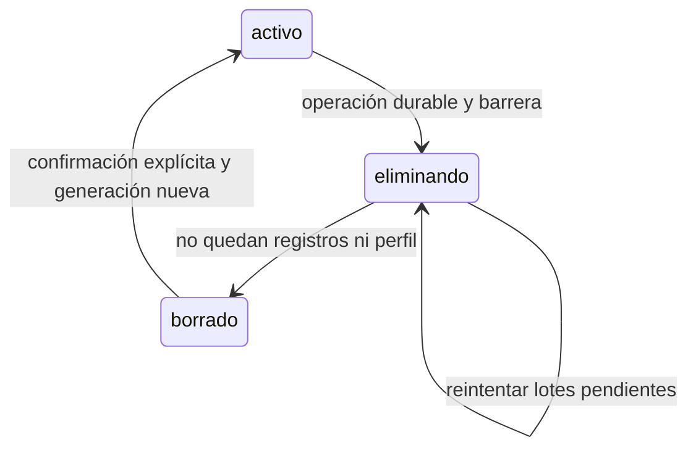

# Primera entrega: guardado, cuentas y privacidad

## Entorno reproducible

Node **24.12.0** (`.node-version` y `engines`), npm y Java **21** para el emulador. La pipeline y Cloud Build usan la misma versión de Node. No se cambia la instalación global del equipo; en esta sesión se usó una copia local ignorada en `.tools/`.

```powershell
npm ci
npm test -- --ci --runInBand
npm run lint
npm run typecheck
npm run test:rules
```

El último comando inicia Firestore local con el proyecto ficticio `demo-nutrimind`, carga `firestore.rules` y prueba cuentas A, B y sin sesión. El runner rechaza ejecutarse si no está presente `FIRESTORE_EMULATOR_HOST`. No requiere credenciales ni modifica la nube. Los mensajes PERMISSION_DENIED de casos negativos son esperados.

La comprobación gradual de JavaScript usa `checkJs`, modo estricto y cero emisión en `persistencia.js` y `sesion.js`. No equivale a tipar todas las pantallas. ESLint revisa el proyecto y exige reglas de hooks y ausencia de catch vacíos; no impone escapar comillas tipográficas en textos JSX. La persistencia de Auth usa la exportación react-native de Firebase: la excepción localizada del resolver ESLint no cambia la resolución de Metro.

## Guardado

`crearPersistencia` serializa todas las escrituras del snapshot. `actualizar(fn, vigente?)` devuelve una promesa que solo confirma tras `setItem`. Su función recibe el último snapshot confirmado, no una captura del render. Un fallo mantiene el estado anterior y una operación posterior puede reintentar. Un JSON ilegible o estructura inválida bloquea inicialización y no provoca una escritura de datos vacíos.

Check-in y Me está costando esperan ese commit, bloquean el envío mientras guardan y conservan el formulario al fallar. Los demás controles muestran el fallo mediante el aviso global. IDs UUID de Expo Crypto se crean antes del commit; la cola pendiente usa esos IDs tras reiniciar. Crypto está disponible en Expo Go; no se agregó un módulo nativo externo.

## Sesión, idempotencia y conflictos

El almacenamiento queda vinculado al UID antes de iniciar red. Cada respuesta captura una cerca de sesión; cerrar sesión, cambiar UID o iniciar borrado invalida respuestas anteriores. No se aplica un resultado de A al estado de B. Una copia conservada al eliminar cuenta requiere confirmación explícita para vincularla de nuevo.

Cada registro de diario existente es inmutable. Una transacción lee control y registro; si el ID y contenido canónico ya existen, no escribe ni cambia su timestamp. Contenido diferente produce conflicto. Una migración de un registro legado solo añade la generación sin alterar su contenido o timestamp.

Perfil mutable: fusión de tres versiones (base, teléfono y nube) por campo y revisión consecutiva en transacción. Cambios disjuntos se combinan; cambios incompatibles no se deciden por reloj del teléfono. Se puede confirmar usar las preferencias de la nube, sin borrar check-ins. Las operaciones de perfil tienen un ID propio para distinguir dos ediciones en el mismo milisegundo.

El pull es completo en esta entrega. Se retiró el cursor global que podía saltarse escrituras concurrentes entre colecciones. Aumenta las lecturas; una optimización futura debe usar cursores independientes y pruebas de concurrencia.

## Ciclo de borrado



`syncControls/{uid}` guarda solo estado, generación e ID de operación. Las reglas rechazan nuevas escrituras durante el borrado y rechazan generaciones viejas después de reiniciar una copia. El marcador no se elimina automáticamente. Una operación interrumpida conserva ID y fase en el snapshot local; se reanuda desde la pantalla de recuperación. El marcador remoto no contiene correo, notas ni mediciones.

**Borrar todos mis datos:** primero nube confirmada, después snapshot local vacío y salida de sesión. **Eliminar cuenta:** reautenticar, borrar nube, eliminar identidad y conservar datos locales desvinculados. No son transacciones globales: Firestore y Firebase Auth son servicios distintos. Una interrupción durante la eliminación de identidad exige recuperar el estado de cuenta; no se anuncia éxito ni se vincula la copia a otra cuenta automáticamente.

Si la nube ya fue confirmada borrada, pero no queda sesión para completar la eliminación de identidad, existe una salida explícita para conservar la copia local y revisar la cuenta después. No se habilita mientras el borrado remoto esté pendiente. No afirma que la identidad fue eliminada y mantiene bloqueada cualquier vinculación automática.

## Sentry

Se retiró la inicialización directa de `App.js`. Solo `reportes.js` inicia el SDK tras consentimiento y con entorno/DSN válidos, fuera de desarrollo. El filtro usa campos permitidos y códigos técnicos: elimina mensajes y contextos arbitrarios, nombres de errores, stacks, usuario, IP, request, logs y replay. Los errores no controlados se agrupan en código genérico para impedir que texto clínico llegue en una excepción. Esta privacidad reduce el detalle de diagnóstico deliberadamente.

La prueba de App comprueba que importar la entrada no inicia el SDK y que el efecto de consentimiento se detiene al borrar. Las pruebas del módulo comprueban la configuración y el filtrado. La verificación real de transporte Sentry en staging y Android development build sigue en el cambio Sentry abierto; no se presume cubierta por Jest ni Expo Go.

## Publicación y compatibilidad

No se desplegaron reglas, ramas ni aplicaciones. El cliente nuevo y las reglas deben verificarse y desplegarse coordinadamente en staging: clientes antiguos no adjuntan generación y serán rechazados por estas reglas. No activar reglas nuevas directamente en producción sin plan de actualización. Las colecciones futuras de bosque/diario siguen cerradas.

La constitución y el contenido clínico no cambiaron. No se configuró CORS porque no hay endpoints HTTP propios; Auth y reglas de Firestore siguen siendo los controles de acceso.

## Dependencias heredadas

La auditoría `npm audit --omit=dev` del lockfile de `origin/main` y la de esta entrega dan el mismo resultado: 17 avisos, 7 de severidad alta (también hay transitivas de herramientas Expo incluidas bajo dependencias de producción). No se han resuelto mediante actualizaciones mayores automáticas. Antes de publicar se debe revisar exposición y aplicar parches compatibles en una tarea de dependencias propia. Las herramientas del emulador solo se agregaron a desarrollo.

## Evidencia de verificación local — 2026-11-07

- Instalación limpia: `npm ci --no-audit --no-fund`, Node 24.12.0, 1536 paquetes, sin EBADENGINE. Persisten avisos de deprecación de transitivas.
- Jest: 9 suites, 94 pruebas aprobadas, incluidos formularios, entrada App, lectura/escritura, sesión, reintentos, perfiles y borrado interrumpido.
- Emulador: 5 pruebas aprobadas con múltiples aserciones sobre aislamiento, datos inmutables, campos/tipos/largos, metadatos legados y barrera remota.
- ESLint sin errores ni advertencias y `tsc --noEmit` aprobado sobre el alcance gradual indicado.
- Exportaciones web y Android generadas con el código de esta entrega. No equivalen a pruebas en dispositivos reales.
- OpenSpec estricto y contrato de versión 1.0.1 válidos. No se publica una versión ni se marca completo el cambio entero: grupos 1–4 terminados, grupos 5–9 pendientes.

Quedan fuera de esta verificación los servicios reales de Auth y Sentry, dispositivos físicos y la pipeline remota; no se activaron ni desplegaron recursos externos.
